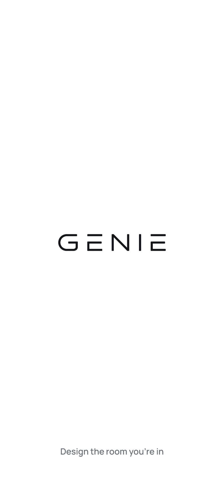
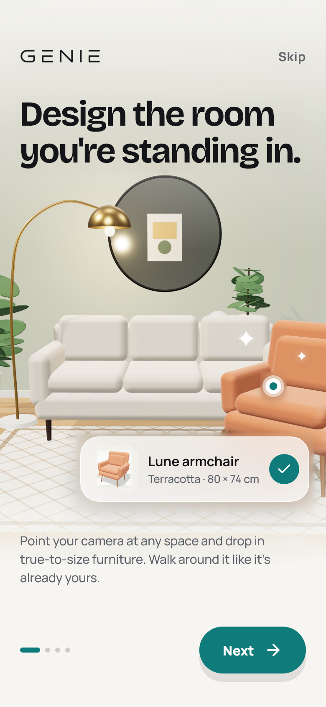
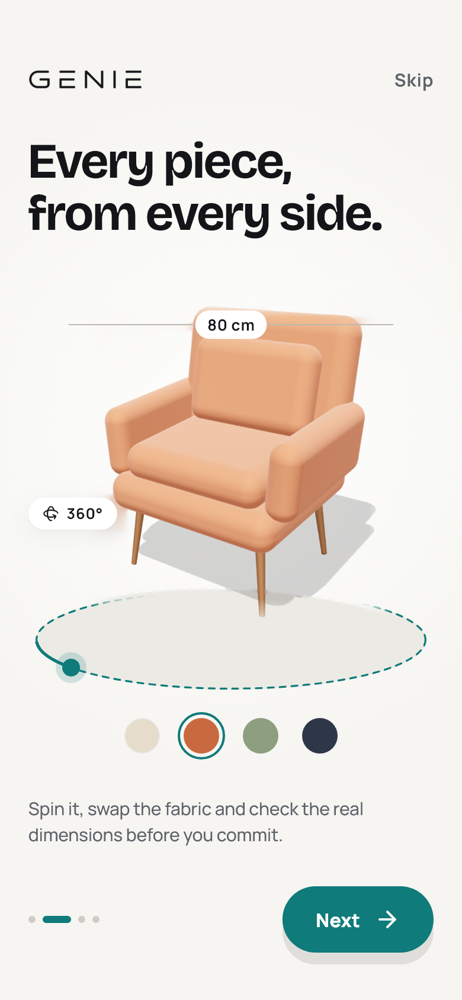
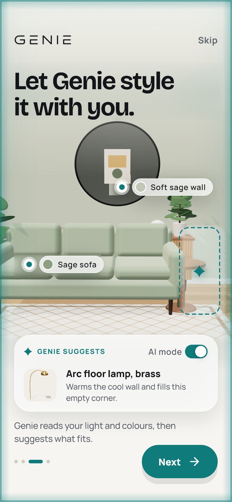
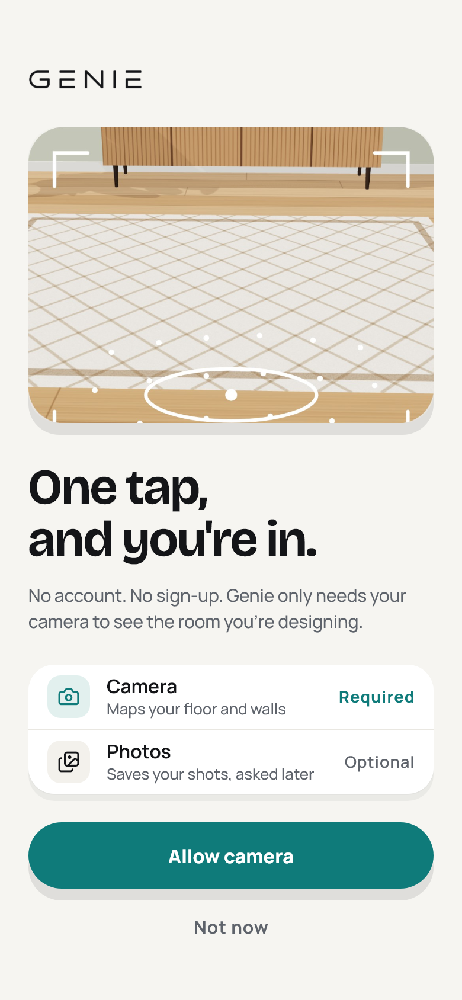
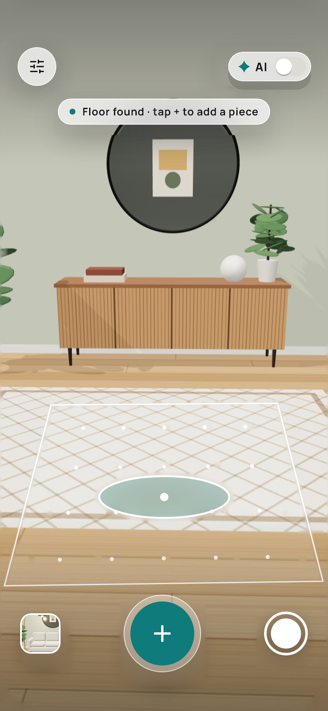
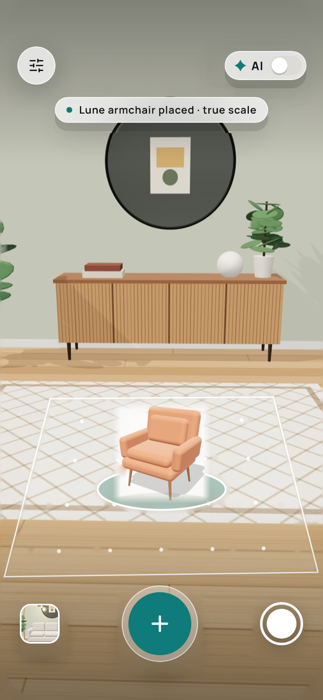
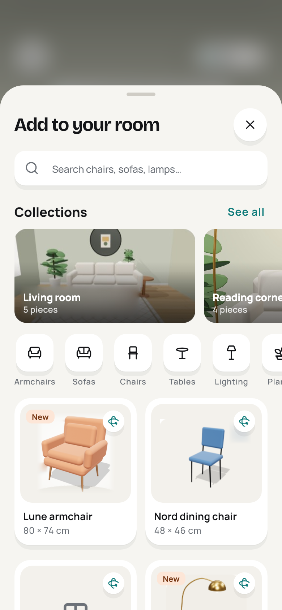
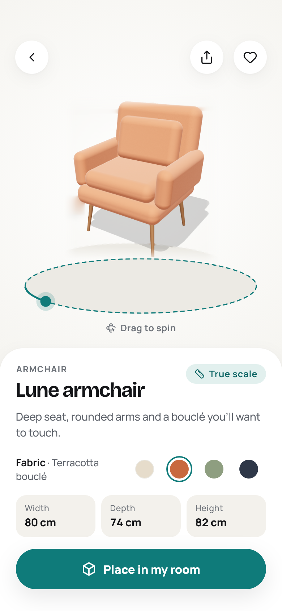
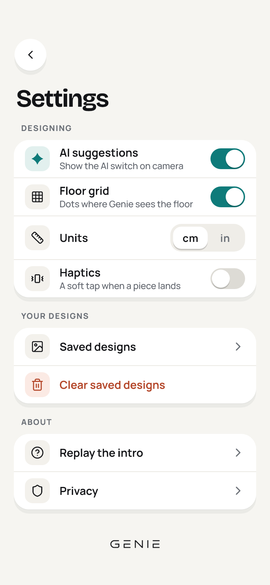

<p align="center">
  
</p>

<p align="center"><strong>Design the room you're in.</strong></p>

<p align="center">
  An augmented-reality interior design app for Android, built with Flutter.<br>
  Point your phone at a room, browse furniture, and place true-to-scale 3D pieces into the real space.
</p>

---

## Contents

- [What Genie is](#what-genie-is)
- [Where the project is today](#where-the-project-is-today)
- [Screens](#screens)
- [The vision](#the-vision)
- [Roadmap](#roadmap)
- [Tech stack](#tech-stack)
- [Getting started](#getting-started)
- [Project structure](#project-structure)
- [Design system](#design-system)
- [Motion](#motion)
- [Testing](#testing)
- [Tooling](#tooling)
- [Known limitations](#known-limitations)
- [Credits](#credits)

---

## What Genie is

Genie answers one question while you are standing in a room: **will this piece fit here, and will it look right?**

- **No account, no sign-up.** It opens straight to the camera. The camera is the only permission it needs up front.
- **True scale.** Every piece is placed at its real size, and its dimensions are always one tap away (cm or inches).
- **Every side.** Spin a piece on a turntable, swap the fabric, and check width, depth and height before you commit.
- **An optional AI assistant.** AI mode reads the room's light, colours and empty corners, and suggests pieces that fit. It is always optional and easy to switch off.

Genie is a utility, not a store: few screens, direct use, quiet and physical motion.

---

## Where the project is today

| Area | Status |
|---|---|
| Design system: tokens, theme, 20+ components | ✅ Done |
| Splash, 4-page onboarding, camera permission flow | ✅ Done |
| Home camera screen: controls, status, reticle, AI switch | ✅ Done |
| Furniture sheet: search, collections, categories, grid | ✅ Done |
| Furniture detail: turntable, fabrics, dimensions, place | ✅ Done (2D stand-in for the 3D viewer) |
| Settings: persisted and applied live | ✅ Done |
| Saved designs and privacy pages | ✅ Done (simple) |
| Live AR on Android: plane detection, centre-screen reticle, true-scale placement, drag and rotate | 🧪 Built, being tested on devices |
| Real 3D viewer on the detail screen | ⏳ Next |
| AI room reading and suggestions | 🔭 Planned (UI is ready, no model yet) |
| iOS | 🔭 Planned |

### What works now

- **Splash.** Pure white; the wordmark settles in, then a crossfade to onboarding (first launch) or Home.
- **Onboarding.** Four pages with a fixed top bar (wordmark, Skip) and bottom bar (page dots, Next):
  1. *Design the room you're standing in.* The placed chair's pin and product card pop in, then sparkles fade up.
  2. *Every piece, from every side.* The chair turns on a turntable you can drag with momentum; swatches recolour it.
  3. *Let Genie style it with you.* Colour reads pop in one by one, the suggestion card slides up, and its AI switch really turns the AI layer on and off.
  4. *One tap, and you're in.* The camera permission page, with calm handling of "denied" and a route to system settings when "blocked".
- **Home.**
  - With camera access on Android, Home shows the live ARCore camera:
    - Detected floor shows as soft white planes; the Floor grid setting hides them live.
    - A reticle breathes while searching and settles when the floor under the screen centre is found.
    - "Place in my room" anchors the model there at real size.
    - Drag a piece to move it; twist with two fingers to rotate it.
  - Without camera access (or in tests), a placeholder room with a simulated AR layer stands in.
- **Furniture sheet.** A draggable sheet that snaps open or away on a fling, while the camera behind dims and blurs in step. Search with an empty state, collections, category filters, and a two-column grid.
- **Detail.** The tile image flies into the detail screen (Hero). The piece spins on a turntable, fabric swatches swap the render, and dimensions show in your units. "Place in my room" returns to Home with the piece placed.
- **Settings.** AI suggestions, Floor grid, Units (cm/in), Haptics, Saved designs, Clear saved designs (with confirmation), Replay the intro, and Privacy. Everything persists and applies the moment it changes.

---

## Screens

The mockups in [`design/`](design/) are the source of truth. The captures below are rendered from the app by the screenshot test at the mockups' 390 × 844 size (see [Testing](#testing)).

| Splash | Onboarding 1 | Onboarding 2 | Onboarding 3 · AI | Onboarding 4 · Camera |
|---|---|---|---|---|
|  |  |  |  |  |

| Home | Home · piece placed | Furniture sheet | Detail | Settings |
|---|---|---|---|---|
|  |  |  |  |  |

The full mockup board is at [`design/00-overview.png`](design/00-overview.png).

---

## The vision

Genie should feel like holding a window into the room's future. You point your phone at a corner, and within seconds you know whether the sofa fits, how the terracotta bouclé looks against your wall, and what would fill the empty space by the window.

### Product principles

1. **The room is the interface.** Get to the camera fast and keep the chrome out of the way.
2. **True scale is a promise.** Dimensions are real and visible whenever they matter.
3. **AI assists, never insists.** It is optional, explained, and easy to switch off.
4. **Nothing asks for more than it needs.** One permission up front, no account.
5. **Quiet, physical, quick.** Motion and feedback feel like objects, not effects.

### Where it is going

- **Real 3D everywhere.** Pieces are true glTF/GLB models: spun on the detail turntable, recoloured live by fabric, and placed in AR with the same model.
- **A grounded AR experience.**
  - Reliable floor detection with a reticle that sits on the real surface.
  - Pieces that drop onto the floor with a soft spring and a light haptic.
  - Move, rotate and remove controls.
  - Realistic lighting from the room.
- **AI mode that genuinely reads the room.**
  - It samples wall, floor and furniture colours ("Soft sage wall", "Sage sofa").
  - It spots empty corners, and suggests pieces that fit the space and the palette, each with a short reason ("Warms the cool wall and fills this empty corner").
  - "Try it here" drops the suggestion straight into the room.
- **Captures worth sharing.** Save a shot of the designed room, see "In this shot" piece chips, and share it or keep the design.
- **Saved designs that come back.** Reopen a saved arrangement and see it again in the room.
- **A real catalog.** Product photography, real models, collections and categories. Prices only once they are decided.
- **iOS.** The same experience on iPhone (ARKit), once the Android version is solid.

---

## Roadmap

The app is being built in phases, with a review after each one.

| Phase | Scope | Status |
|---|---|---|
| 1 | Theme, design tokens, core components, component gallery | ✅ Done |
| 2 | Splash, onboarding, permissions, onboarding motion | ✅ Done |
| 3 | Home camera screen (placeholder feed), overlays, AI toggle | ✅ Done |
| 4 | Furniture sheet and detail, catalog repository, Hero, fabrics | ✅ UI done · 3D viewer pending |
| 5 | Settings, fully persisted and live | ✅ Done |
| 6 | AR: package research, plane detection, reticle hit test, true-scale placement with move and rotate | 🧪 In device testing |
| 7 | Polish: design review, motion review, fixes | ⏳ Next |

**Next up**

- Verify AR end to end on real devices.
- Add a real 3D viewer on the detail screen, with per-fabric models so swatches recolour the model.
- Replace the placeholder illustrations and product images with final, layered art.
- Wire AI mode to a real model (room colour reading and suggestions).
- iOS: a centre-screen hit test in the AR bridge, and USDZ models.

---

## Tech stack

| | |
|---|---|
| Framework | Flutter (Dart 3), Material 3, heavily themed |
| State | [Riverpod](https://riverpod.dev) 3 (no code generation) |
| Navigation | [go_router](https://pub.dev/packages/go_router) |
| Storage | [shared_preferences](https://pub.dev/packages/shared_preferences) for settings, the onboarding flag and saved designs |
| Permissions | [permission_handler](https://pub.dev/packages/permission_handler) |
| AR | [ar_flutter_plugin_plus](https://pub.dev/packages/ar_flutter_plugin_plus) (ARCore + Filament on Android), vendored with Genie changes, see [`packages/`](packages/ar_flutter_plugin_plus/README.md) |
| Icons | [lucide_icons_flutter](https://pub.dev/packages/lucide_icons_flutter), plus two drawn glyphs (dining chair, pedestal table) |
| Fonts | Bricolage Grotesque (display) and Manrope (body), bundled for offline use |
| Version info | [package_info_plus](https://pub.dev/packages/package_info_plus) |

No backend and no accounts, by design (for now).

### Why ar_flutter_plugin_plus, vendored

It is the maintained Flutter AR plugin that renders glTF/GLB with Filament on Android and supports:

- plane detection
- anchoring a model where a hit test lands
- pan and rotate gestures
- snapshots

The copy in `packages/ar_flutter_plugin_plus` adds what Genie needs:

- `hitTestScreen`: a hit test at any screen point, used every ~120 ms at the screen centre for the reticle.
- `setShowPlanes`: shows or hides detected planes without restarting the session.
- Soft white planes instead of the stock blue.
- Cloud anchors disabled: the published handler used ARCore APIs removed in 1.40+ and no longer compiled. This also drops `play-services-auth`.

Every change is marked `Genie:` in the source.

---

## Getting started

### Requirements

- Flutter SDK with Dart 3.7 or newer. The project currently builds on the beta channel (Flutter 3.41).
- An **ARCore-supported Android phone** (Android 7.0 / API 24 minimum; the target is high-end Android 13+). Genie is declared *AR Required*, so Google Play installs ARCore with it.
- Android SDK 36.

### Run

```bash
git clone https://github.com/Elvisnc9/Genie.git
cd Genie
flutter pub get
flutter run            # on a connected Android device
```

The first Android build downloads ARCore and Filament and can take several minutes.

- To see the live AR camera, grant camera access during onboarding.
- Without it, Home shows the placeholder room.
- To replay onboarding: Settings → Replay the intro.

### Component gallery

A live preview of every core component lives at the `/gallery` route ([`lib/features/gallery/gallery_screen.dart`](lib/features/gallery/gallery_screen.dart)). It is handy when working on the design system.

---

## Project structure

```
lib/
  app/                  app.dart (MaterialApp.router), router.dart (routes + transitions)
  core/
    ar/                 genie_ar.dart: AR session, centre hit test, true-scale placement
    data/               catalog repository, settings, onboarding flag, camera permission,
                        placed pieces and saved designs (Riverpod notifiers)
    feedback/           haptics (respects the Haptics setting)
    models/             FurnitureItem, Fabric, Collection, PlacedPiece, AppSettings, Units
    theme/              colours, typography, spacing, radii, shadows, motion, icons, art
    widgets/            reusable components (buttons, glass, toggles, cards, scene marks…)
  features/
    splash/  onboarding/  home/  catalog/  detail/  settings/  gallery/
assets/
  brand/                wordmark (ink and white)
  fonts/                Bricolage Grotesque, Manrope (+ OFL licences)
  images/               placeholder illustrations and product renders
  models/               placeholder .glb models
  data/catalog.json     seed catalog (no prices)
design/                 mockups (source of truth)
packages/               vendored ar_flutter_plugin_plus
tool/                   asset scripts (Python)
test/                   unit, widget, golden and screenshot tests
PRODUCT.md              product context: users, purpose, principles
```

---

## Design system

**Light theme only**, warm white and airy. Every colour, size and text style comes from tokens in [`lib/core/theme/`](lib/core/theme/). No screen hard-codes them.

| Token | Value | Use |
|---|---|---|
| `bg` | `#F6F5F1` | Warm white app background |
| `card` | `#FFFFFF` | Cards, groups, sheets |
| `ink` / `ink2` / `ink3` | `#141518` / `#5E636B` / `#6C7178` | Text: primary, secondary, captions |
| `teal` | `#0F7B7A` | The one accent: primary buttons, selection, toggles, reticle |
| `tealSoft` | `#E2F0EE` | Tinted icon wells, chips |
| `danger` | `#B4472A` | Destructive actions |

- **Glass** for controls over the camera: white at 74%, 22 blur, a 1px white edge, and a soft neutral shadow.
- **Type:** Bricolage Grotesque 700 for headlines (−3.5% tracking); Manrope for everything else. Eyebrows are 11.5 pt uppercase with +10% tracking.
- **Shape:** fully rounded primary buttons (56 tall), 22 pt cards and groups, 16 pt tiles, a 32 pt sheet top.
- **Touch targets are at least 48 pt.** Icon-only buttons carry screen-reader labels, and body text meets 4.5:1 contrast.

---

## Motion

Motion is physical, quick and quiet, following Emil Kowalski's decision order. Tokens are in [`motion.dart`](lib/core/theme/motion.dart).

- **Springs for anything you touch.** They are interruptible and keep their velocity: press scale (0.97), toggle knobs, segmented thumbs, sheet snapping.
- **Press feedback starts on the raw pointer.** It fires the moment the finger lands, not after Flutter waits to rule out a scroll.
- **Scroll-driven, not timed.** Onboarding page dots and copy parallax follow the pager's position.
- **Delight only where it is rare.** Onboarding pop-ins (scale 0.85 → 1 with a spring, staggered 60 ms), the colour reads, the suggestion card.
- **Respects "remove animations".** With the system setting on, movement turns into simple fades or instant changes.

---

## Testing

```bash
flutter test                                   # everything
flutter test --update-goldens test/goldens     # refresh component goldens
flutter test --update-goldens test/screens     # refresh full-screen captures (390 × 844)
dart analyze lib test
```

- **Unit:** catalog parsing and integrity (every asset and model exists), settings persistence, the onboarding flag, placing pieces, saved designs, unit formatting.
- **Widget:** component behaviour, touch targets, semantics, reduced motion; the onboarding flow with a fake permission service (granted, denied, blocked, returning user).
- **Goldens:** core components, plus full-screen captures used for design review against [`design/`](design/).

---

## Tooling

- [`tool/extract_art.py`](tool/extract_art.py) builds the placeholder illustrations from the mockups. It cuts out the room renders and removes the baked-in UI by inpainting, so the app can draw that UI live and animate it. It also produces the recoloured chair renders. Needs Python with Pillow and numpy.
- [`tool/model_bounds.py`](tool/model_bounds.py) measures a .glb's real-world size. The catalog's `modelScale` comes from this.

---

## Known limitations

- **Placeholder art.** Illustrations and some product images are cut from the mockups; a few faint inpainting marks remain. Final layered art will replace them.
- **2D detail viewer.** The detail turntable rocks a flat render in perspective until the real 3D viewer lands. Only the Lune armchair has per-fabric renders.
- **Placeholder models.** Only two pieces have 3D models, and they are stand-ins, not the actual products. Fabric choices don't change the AR model yet.
- **Placeholder catalog data.** Lune and Nord dimensions come from the mockups; the rest of the catalog data are placeholders.
- **AI mode is UI only.** The switch, edge glow and suggestion card exist; no model reads the room yet.
- **Android first.** The AR reticle's centre hit test is Android-only; iOS needs the bridge extended and USDZ models.
- **Unfinished features.** Share is not implemented, and favourites last only for the session.

---

## Credits

- **Placeholder 3D models** from the [Khronos glTF Sample Assets](https://github.com/KhronosGroup/glTF-Sample-Assets):
  - *SheenChair* by Eric Chadwick for Wayfair, LLC: [CC0 1.0](https://creativecommons.org/publicdomain/zero/1.0/).
  - *GlamVelvetSofa* by Eric Chadwick for Wayfair, LLC: [CC BY 4.0](https://creativecommons.org/licenses/by/4.0/).
- **Fonts:** [Bricolage Grotesque](https://fonts.google.com/specimen/Bricolage+Grotesque) and [Manrope](https://fonts.google.com/specimen/Manrope), both under the SIL Open Font License (licences in [`assets/fonts/`](assets/fonts/)).
- **AR:** [ar_flutter_plugin_plus](https://github.com/FranzGraaf/ar_flutter_plugin_plus) by Franz Graaf (MIT), vendored with changes.
- **Icons:** [Lucide](https://lucide.dev) (ISC).
